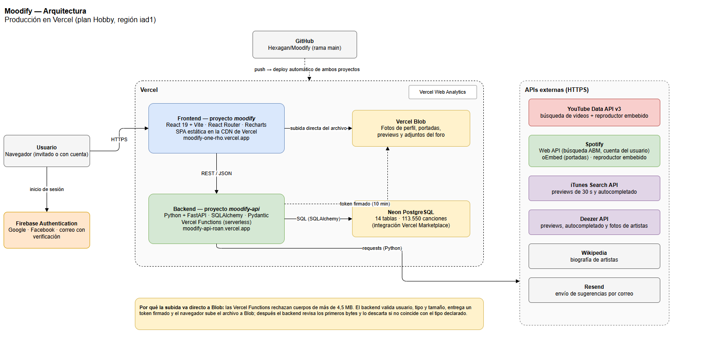

# Moodify — Emociones Musicales

**Moodify** es una aplicación web para explorar música según su perfil emocional. A partir de un dataset público de Spotify con más de 113.000 canciones, permite recorrer el catálogo por valencia, energía y género, descubrir canciones en un mapa emocional, analizar géneros con gráficos interactivos y recibir recomendaciones personales.

🌐 **En producción:** https://moodify-one-rho.vercel.app  
📚 **API:** https://moodify-api-roan.vercel.app/docs
📋 **Presentación:** https://canva.link/qsw35t0tocuh3nl

---

## 🎵 Características principales

- 🗺️ **Mapa emocional** de valencia × energía: un clic sugiere canciones de ese estado de ánimo
- 📚 **Catálogo** con búsqueda, filtro por género, rangos por columna, ordenamiento y paginación
- 📈 **Análisis** por género (popularidad, contenido explícito, loudness, mapa psicológico) enlazado al catálogo
- 🎧 **Previews y videos**: Apple Music, Deezer, Spotify y YouTube integrados en un reproductor propio
- ✨ **Recomendaciones personales** según los me gusta y el historial de escucha
- 👥 **Funciones sociales**: perfiles, amigos, comentarios, reacciones, playlists y foro por artista
- 🔐 **Cuentas** con Google, Facebook o correo verificado; rol de administrador para el ABM
- 🛠️ **ABM de canciones** con autocompletado desde iTunes, Deezer, Spotify y YouTube
- 🎨 **Configuración**: modo claro/oscuro, perfiles de color, accesibilidad, conexión con Spotify y YouTube
- ✉️ **Contacto** para enviar sugerencias, y política de privacidad pública

---

## 🏗️ Arquitectura



| Capa | Tecnología | Dónde corre |
|------|-----------|-------------|
| Frontend | React 19 + Vite, React Router, Recharts | Vercel (CDN) |
| Backend | Python + FastAPI, SQLAlchemy, Pydantic | Vercel Functions |
| Base de datos | PostgreSQL (14 tablas) | Neon |
| Archivos | Vercel Blob | Vercel |
| Autenticación | Firebase Authentication | Google |
| APIs externas | YouTube Data API, Spotify, iTunes, Deezer, Wikipedia, Resend | — |

Diagramas editables (draw.io) en [`docs/diagramas/`](docs/diagramas/): arquitectura y diagrama entidad-relación.

---

## 🚀 Inicio rápido (local)

Requisitos: Python 3.10+, Node.js 20+, PostgreSQL 15+ y un proyecto de Firebase.

```bash
# 1. Base de datos
psql -U postgres -c "CREATE DATABASE moodify;"
pg_restore -U postgres -d moodify --no-owner database/moodify.backup

# 2. Backend
cd backend
python -m venv .venv
.\.venv\Scripts\Activate.ps1        # Windows (macOS/Linux: source .venv/bin/activate)
pip install -r requirements.txt
uvicorn main:app --reload --port 8000

# 3. Frontend (otra terminal; antes crear frontend/.env con VITE_API_URL y VITE_FIREBASE_*)
cd frontend
npm install
npm run dev
# http://localhost:5173
```

Detalle completo, variables de entorno y despliegue: [docs/guia-instalacion.md](docs/guia-instalacion.md).

---

## 📖 Documentación

| Documento | Descripción |
|-----------|-------------|
| [guia-instalacion.md](docs/guia-instalacion.md) | Instalación local y despliegue en Vercel |
| [documentacion-tecnica.md](docs/documentacion-tecnica.md) | Arquitectura, base de datos, API, seguridad, despliegue |
| [diccionario-datos.md](docs/diccionario-datos.md) | Campos de cada tabla y API de canciones |
| [manual-usuario.md](docs/manual-usuario.md) | Guía de uso |
| [modulo-abm.md](docs/modulo-abm.md) | Gestión de canciones |
| [pantallas.md](docs/pantallas.md) | Páginas de la interfaz |
| [requisitos-funcionales.md](docs/requisitos-funcionales.md) | Requisitos funcionales y no funcionales |
| [casos-prueba.md](docs/casos-prueba.md) | Casos de prueba |
| [diagramas/](docs/diagramas/) | Arquitectura y DER (draw.io + PNG) |
| [presentacion/](docs/presentacion/) | Guion de la demo y texto de las diapositivas |

---

## 📁 Estructura del proyecto

```
Moodify/
├── backend/            # API FastAPI
│   ├── main.py         # App, CORS, routers, creación de tablas
│   ├── models.py       # 14 modelos SQLAlchemy
│   ├── routers/        # canciones, stats, media, usuarios, amigos, likes, comentarios,
│   │                   # musica, playlists, configuracion, artistas, subidas, contacto
│   ├── recommender.py  # Recomendaciones por similitud de atributos
│   ├── storage.py      # Vercel Blob / carpeta local
│   └── set_admin.py    # Asignar administradores
├── frontend/           # SPA React + Vite
│   └── src/            # pages, components, context, services, utils
├── database/           # Respaldo (moodify.backup), schema, dataset original y consultas
├── docs/               # Documentación, diagramas y material de presentación
└── powerbi/            # Dashboards complementarios
```

---

## 🔌 API REST

75 endpoints agrupados en `/canciones`, `/stats`, `/media`, `/usuarios`, `/amigos`, `/likes`, `/comentarios`, `/musica`, `/playlists`, `/configuracion`, `/artistas`, `/subidas` y `/contacto`. La referencia interactiva la genera FastAPI en `/docs`.

---

## 🧪 Pruebas

```bash
cd frontend
npm run lint
npm run build
```

Casos de prueba manuales en [docs/casos-prueba.md](docs/casos-prueba.md).

---

## 👥 Equipo

| Integrante | Rol | Tecnología |
|-----------|-----|-----------|
| Jonathan (Jony) | Base de Datos | PostgreSQL, SQL |
| Valentín (Valen) | Diseño / Frontend | Figma, React |
| Lucas | Backend | Python, FastAPI |
| Fede | Frontend | React, Recharts |
| Mauro Di Gallo | Visualización / QA / Docs | Power BI, Testing |

---

## 📋 Próximos pasos

- Verificar el token de Firebase en cada request del backend
- Tests automatizados con pytest
- Normalizar géneros y artistas del dataset en tablas propias
- Vista de sugerencias recibidas en el ABM
- Exportación de reportes (PDF / CSV)

---

## 📝 Licencia

Proyecto académico. Derechos reservados.

---

**Última actualización:** Noviembre 2026
